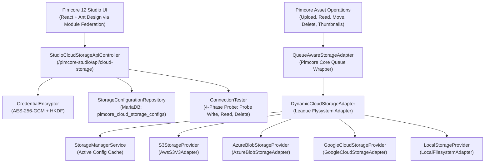

# Pimcore 12 Cloud Storage Manager Bundle

[](https://pimcore.com)
[](https://php.net)
[](https://symfony.com)
[](LICENSE)

A production-ready **Pimcore 12 Studio UI** extension that enables business administrators to configure, test, verify, activate, and manage external cloud asset storage providers directly from Pimcore Studio without manually modifying PHP code, YAML files, environment variables, or server configurations.

---

## 🌟 Key Features

- **Multi-Cloud Support**:
  - **Amazon S3 & S3-Compatible**: AWS S3, MinIO, Ceph, Cloudflare R2, Wasabi, DigitalOcean Spaces, Backblaze B2.
  - **Microsoft Azure Blob Storage**: Azure Storage Accounts, Blob Containers, and Azurite emulator.
  - **Google Cloud Storage (GCS)**: Google Cloud Platform storage buckets.
  - **Local Filesystem**: Built-in baseline fallback.
- **5-Step Guided Setup Wizard**:
  - **Step 1: Choose Provider**: Simple cards with provider logos, descriptions, and non-technical explanations.
  - **Step 2: Connection Details**: Provider-specific conditional fields, IAM roles / Workload Identity support, secure credential masking.
  - **Step 3: Test Connection**: Live 4-phase probe testing (Container accessibility, Canary Write, Canary Read verification, and guaranteed Canary Delete cleanup) with microsecond latency reporting.
  - **Step 4: Storage Behavior**: Configure asset binary placement, metadata retention, and thumbnail caching options.
  - **Step 5: Review & Activate**: Detailed configuration summary, operational warnings, and explicit confirmation before switching active storage.
- **Live Cloud Storage Dashboard**:
  - Real-time connection health badges (`Connected`, `Failed`, `Attention Needed`).
  - Active provider banner showing target bucket, region, and last verified test timestamp.
  - One-click connection test from the dashboard.
- **Dynamic Hot-Swapping Storage Architecture**:
  - `DynamicCloudStorageAdapter` wraps the active provider at runtime.
  - Preserves Pimcore 12's `Pimcore\Asset\StorageQueue\QueueAwareStorageAdapter` for transparent folder moves and background deletes.
  - Zero-restart activation: switching active storage takes effect immediately.
- **Enterprise Credential Security**:
  - Credentials encrypted with **AES-256-GCM** using keys derived via HKDF from `PIMCORE_ENCRYPTION_SECRET`.
  - Plaintext secrets are **never** returned to the browser or leaked in API responses.
  - Automatic redaction of access keys, connection strings, and private keys from application logs and exception traces.
  - Role-based permissions (`PIMCORE_CLOUD_STORAGE_VIEW` and `PIMCORE_CLOUD_STORAGE_MANAGE`).
- **Asset Migration Assistant**:
  - Preflight scanner estimating file counts and total bytes before migrating.
  - Resumable streaming copy (skips already migrated files with matching sizes).
  - Stream-based transfers with constant $O(1)$ memory usage.
  - Progress reporting and error logging.
- **CLI Commands**:
  - `bin/console pimcore:cloud-storage:status`
  - `bin/console pimcore:cloud-storage:test [name]`
  - `bin/console pimcore:cloud-storage:activate <name>`
  - `bin/console pimcore:cloud-storage:migrate --target=<name> [--dry-run]`

---

## 📦 Architecture Overview



---

## 🚀 Installation

### 1. Require the bundle via Composer

```bash
composer require vezolabs/pimcore-cloud-storage-bundle
```

### 2. Enable the bundle in `config/bundles.php`

```php
return [
    // ...
    Vezolabs\CloudStorageBundle\VezolabsCloudStorageBundle::class => ['all' => true],
];
```

### 3. Install the bundle database schema and permissions

```bash
bin/console pimcore:bundle:install VezolabsCloudStorageBundle
```

### 4. Install assets

```bash
bin/console assets:install
bin/console cache:clear
```

---

## 💻 CLI Commands

### View Active Storage & Diagnostics

```bash
bin/console pimcore:cloud-storage:status
```

### Test Any Storage Configuration

```bash
# Test active storage
bin/console pimcore:cloud-storage:test

# Test specific configuration
bin/console pimcore:cloud-storage:test s3-production
```

### Activate a Storage Configuration

```bash
bin/console pimcore:cloud-storage:activate s3-production
```

### Migrate Assets Between Providers

```bash
# Dry-run preflight validation
bin/console pimcore:cloud-storage:migrate --target=s3-production --dry-run

# Run full migration
bin/console pimcore:cloud-storage:migrate --target=s3-production
```

---

## 🧪 Automated Testing

Run the automated test suite:

```bash
vendor/bin/phpunit -c cloud-storage/phpunit.xml.dist
```

---

## 📄 Documentation

- [System Architecture](docs/ARCHITECTURE.md)
- [Provider Setup Guide (AWS, Azure, GCS)](docs/PROVIDER_SETUP_GUIDE.md)
- [Asset Migration Guide](docs/MIGRATION_GUIDE.md)
- [Security & Credential Management](docs/SECURITY.md)
- [Troubleshooting & Diagnostics](docs/TROUBLESHOOTING.md)

---

## 🛡 License

This bundle is licensed under the MIT License. See [LICENSE](LICENSE) for details.
