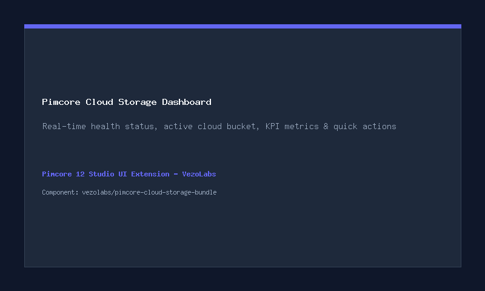
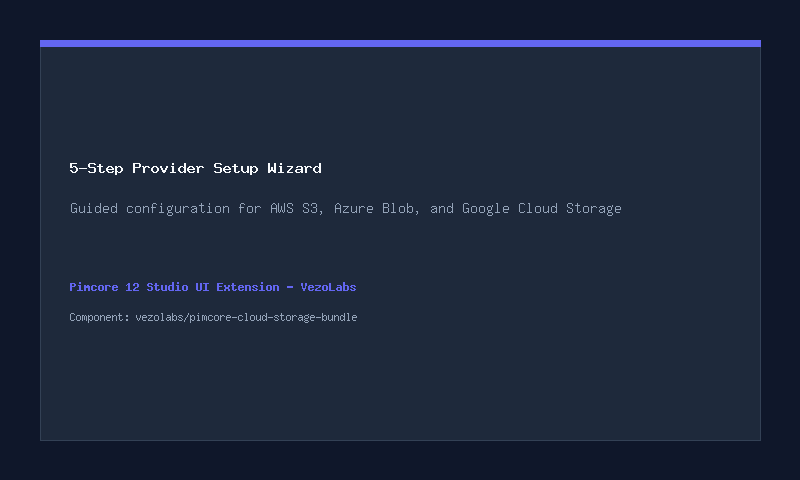
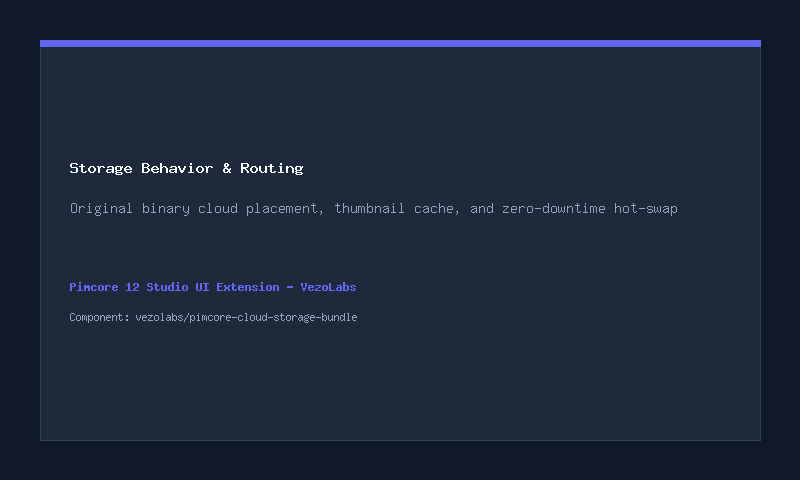
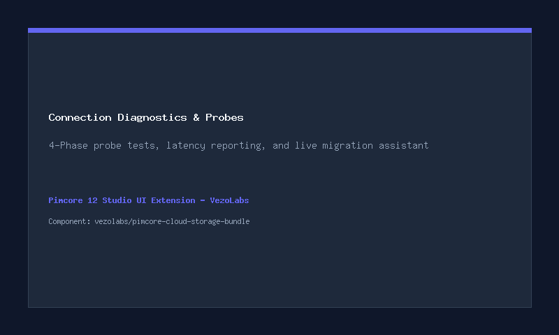
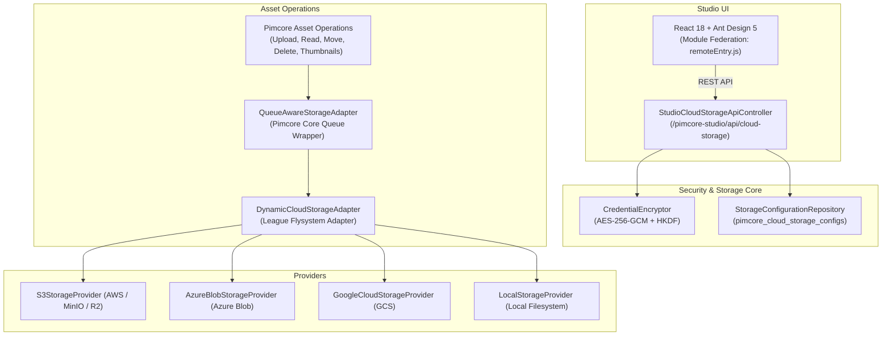

# Pimcore Cloud Storage Manager
[](https://github.com/vezolabs/pimcore-cloud-storage-bundle/actions/workflows/ci.yml)
[](LICENSE)
[](https://php.net)
[](https://pimcore.com)
[](https://packagist.org/packages/vezolabs/pimcore-cloud-storage-bundle)

**Pimcore Cloud Storage Manager** is an enterprise-grade extension built for **Pimcore 12 Studio**. It enables business administrators to configure, test, migrate, and activate external cloud asset storage providers (Amazon S3, Microsoft Azure Blob Storage, Google Cloud Storage, and compatible S3 services) directly from the browser without editing PHP, YAML, environment variables, or server configurations.

Technical administrators install the package once via Composer. From that point forward, all routine operations, provider setup, live connection testing, and asset migrations are handled directly through the **Pimcore Studio UI** (accessible via **Settings → Cloud Storage**).

---

## Screenshots & Interface
<!-- Visual placeholders: Drop screenshots into docs/images/ -->
| Cloud Storage Dashboard | 5-Step Guided Provider Wizard |
| :---: | :---: |
|  |  |
| Storage Behavior & Active Backend | Connection Diagnostics & Probes |
| :---: | :---: |
|  |  |

---

## Video Walkthrough
<!-- Video walkthrough placeholder -->
> A video walkthrough covering installation, configuration, and practical usage will be linked here.
> 
> [-red?logo=youtube)](https://vezolabs.com)

---

## Key Features

- **Multi-Cloud Provider Support**: Seamless integrations for **Amazon S3** (and S3-compatible: MinIO, Ceph, Cloudflare R2, Wasabi, Backblaze B2), **Microsoft Azure Blob Storage**, **Google Cloud Storage (GCS)**, and local application filesystem fallback.
- **5-Step Guided Setup Wizard**: Visual cards, provider-specific conditional forms, real 4-phase probe testing, storage behavior rules, and review & explicit activation.
- **Zero-Downtime Hot-Swapping**: Runtime dynamic Flysystem adapter (`DynamicCloudStorageAdapter`) decorates Pimcore's `QueueAwareStorageAdapter` so provider switching takes effect immediately across all requests without server restarts.
- **Enterprise Credential Security**: Credentials encrypted at rest using **AES-256-GCM** with HKDF key derivation from `PIMCORE_ENCRYPTION_SECRET`. Zero secrets leaked in API payloads or browser displays; automated sanitization of keys and connection strings from application logs and exception traces.
- **Resumable Asset Migration Assistant**: Preflight scan calculating total files and bytes, followed by memory-efficient $O(1)$ stream-based transfers with resume capability and audit tracking.
- **Native Studio Integration**: Directly embedded into Pimcore 12 Studio via Module Federation without legacy ExtJS or jQuery dependencies.

---

## System Requirements & Compatibility

| Requirement | Supported Version |
|---|---|
| **Pimcore** | Pimcore 12 (`^2025.0` or `^2026.0`) with Studio UI |
| **PHP** | `^8.2`, `^8.3`, `^8.4`, `^8.5` |
| **Database** | MariaDB 10.6+ or MySQL 8.0+ |
| **Symfony** | `^6.4`, `^7.0`, `^8.0` |

---

## Legacy Pimcore Support & Customization

Need this functionality for an earlier Pimcore version, or require custom integrations?
- **Pimcore 6, Pimcore 10, or Pimcore 11**: Dedicated builds and backports tailored for classic Pimcore architectures.
- **Custom Enterprise Integrations**: Bespoke feature development, custom storage adapters, and private cloud integrations.

👉 **[Contact VezoLabs for Customization & Legacy Support](https://vezolabs.com/contact)**

---

## Installation

### Quick One-Line Install
Run the following command in your Pimcore project root:
```bash
composer require vezolabs/pimcore-cloud-storage-bundle && \
bin/console pimcore:bundle:install VezolabsCloudStorageBundle && \
bin/console assets:install public && \
bin/console cache:clear
```

### Step-by-Step Installation

#### 1. Require Package via Composer
```bash
composer require vezolabs/pimcore-cloud-storage-bundle
```

#### 2. Enable Bundle
If not auto-registered by Symfony Flex, add the bundle to `config/bundles.php`:
```php
return [
    // ...
    Vezolabs\CloudStorageBundle\VezolabsCloudStorageBundle::class => ['all' => true],
];
```

#### 3. Run Bundle Installer & Migrations
```bash
bin/console pimcore:bundle:install VezolabsCloudStorageBundle
```

#### 4. Publish Frontend Assets & Clear Cache
```bash
bin/console assets:install public
bin/console cache:clear
```

---

## Architecture Overview



---

## CLI Management Commands

For automated environments, CI/CD pipelines, and DevOps workflows:

```bash
# View active storage backend and health diagnostics
bin/console pimcore:cloud-storage:status

# Run 4-phase connection probe on a configuration
bin/console pimcore:cloud-storage:test aws-s3-prod

# Switch active storage provider with zero application restart
bin/console pimcore:cloud-storage:activate aws-s3-prod

# Migrate assets between storage backends
bin/console pimcore:cloud-storage:migrate --source=local-default --target=aws-s3-prod --dry-run
```

---

## Documentation

Detailed documentation is available in the `docs/` directory:

- [Architecture & Design Details](docs/ARCHITECTURE.md)
- [Provider Setup Guide (AWS S3, Azure, GCS, MinIO, R2)](docs/PROVIDER_SETUP_GUIDE.md)
- [Asset Migration Guide](docs/MIGRATION_GUIDE.md)
- [Security & Encryption Model](docs/SECURITY.md)
- [Troubleshooting & Diagnostics Guide](docs/TROUBLESHOOTING.md)

---

## Contributing

Contributions are welcome. Please read [CONTRIBUTING.md](CONTRIBUTING.md) for coding standards and test execution.

---

## License

This project is licensed under the [MIT License](LICENSE).

---

## Commercial Support & Consulting

VezoLabs provides professional consulting, enterprise deployment, and custom Pimcore development.

- **Website**: [https://vezolabs.com](https://vezolabs.com)
- **Inquiries**: [https://vezolabs.com/contact](https://vezolabs.com/contact)
